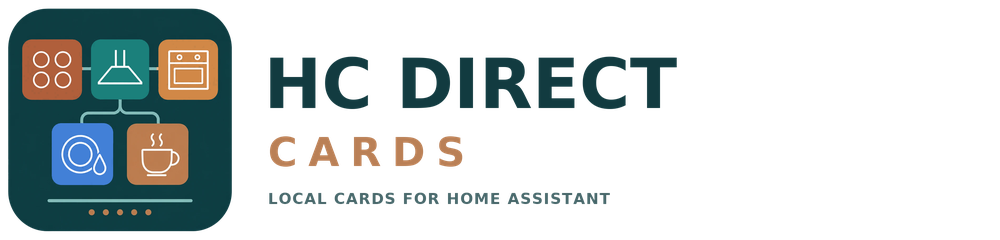

<p align="center">
<picture>
<source media="(prefers-color-scheme: dark)" srcset="https://raw.githubusercontent.com/Asmir1975/hc-direct-cards/main/assets/logo-dark.png">

</picture>
</p>
<p align="center"><strong>Fünf Küchengeräte. Eine klare Bedienung.</strong></p>
<p align="center"><a href="README.md">English</a> · <a href="README.de.md">Deutsch</a></p>
<p align="center">
<a href="LICENSE"></a>
<a href="https://github.com/Asmir1975/homeconnect_direct"></a>


</p>

**HC Direct Cards** bringt Kochfeld, Dunstabzugshaube, Ofen, Geschirrspüler und
Kaffeemaschine als eigene Karten in Home Assistant. Entwickelt von
[Asmir1975](https://github.com/Asmir1975) für
[Home Connect Direct](https://github.com/Asmir1975/homeconnect_direct).

Gerät im visuellen Editor auswählen; die Karte ordnet vorhandene Entitäten
automatisch zu. Die Hauptansicht zeigt die tägliche Bedienung. Weitere Werte
und Einstellungen lassen sich aufklappen.

> Entwicklungsstand **0.3.0-dev.1** zur lokalen Prüfung. Noch kein veröffentlichter
> Release. Die Gestaltung der Detailansicht wird noch bewertet.

## Die fünf Karten

| Gerät | Kartentyp | Funktionen |
|---|---|---|
| Kochfeld | `custom:hc-direct-hob-card` | Vier Zonen, Restwärme, Zeitwerte; gemeldetes Join und powerMove |
| Dunstabzugshaube | `custom:hc-direct-hood-card` | Vorhandene Lüfterstufen, Licht und Dimmung, Filterwerte |
| Ofen | `custom:hc-direct-oven-card` | Programm, Solltemperatur, Dauer und vorhandene Zusatzfunktionen |
| Geschirrspüler | `custom:hc-direct-dishwasher-card` | Programm, Start/Abbruch, Restzeit und Meldungen |
| Kaffeemaschine | `custom:hc-direct-coffee-card` | Getränk, Menge, aromaSelect, Stärke und vorhandene Zusatzfunktionen |

Es werden nur Funktionen angezeigt, denen eine passende Entität zugeordnet ist.
Die Karte erweitert nicht die Fähigkeiten der Integration.

## Sprachen

Die Karten folgen der Home-Assistant-Sprache: **Deutsch** und **Englisch**.
Die Feldbezeichnungen entsprechen in beiden Sprachen den Entity-Namen von
Home Connect Direct 1.13.0 und passen damit zur Entitätenliste in Home Assistant.
Jede andere Sprache fällt auf Englisch zurück. Auswahl- und Zustandsnamen stammen
von Home Assistant selbst.

## Installation

Voraussetzung ist eine eingerichtete **Home Connect Direct 1.13.0** Integration
mit verfügbaren Geräten. Der geprüfte Entity-Vertrag heißt `homeconnect_ws`.
Die offizielle Home-Connect-Cloud-Integration hat eine andere Entity-Struktur.

### Manuell

1. `dist/home-connect-direct-cards.js` nach
   `/config/www/hc-direct-cards/home-connect-direct-cards.js` kopieren.
2. Unter **Einstellungen → Dashboards → Ressourcen** als **JavaScript-Modul** eintragen:

   ```text
   /local/hc-direct-cards/home-connect-direct-cards.js?v=0.3.0-dev.1
   ```

3. Browser vollständig neu laden.
4. Eine Karte hinzufügen, zum Beispiel:

   ```yaml
   type: custom:hc-direct-coffee-card
   ```

5. Im visuellen Editor das Gerät auswählen.

Nur eine Version dieses Kartenpakets gleichzeitig laden. Vorhandene
`hc-direct`-Kartentypen bleiben gültig. Bei bestehenden Karten im Reiter
**Layout** die empfohlene Größe verwenden oder 12 Spalten wählen.

### HACS (nach Veröffentlichung)

Das Repository enthält `hacs.json` und das gebaute JavaScript in `dist`.
Nach Veröffentlichung kann es als benutzerdefiniertes **Dashboard**-Repository
hinzugefügt werden. Ein tatsächlicher HACS-Installations- oder Update-Test
ist noch offen. [Installationsdetails](docs/INSTALLATION.md).

## Automatische Geräteerkennung

Die Auswahl speichert die Geräte-ID. Die Zuordnung verwendet Entity-Registry,
Integrationsplattform und stabile Entity-Schlüssel. Umbenannte Entity-IDs können
bei einer erneuten Registry-Auflösung berücksichtigt werden.
Deaktivierte, ausgeblendete oder fehlende Entitäten werden nicht automatisch
verwendet. Mehrdeutige Zuordnungen bleiben leer. Manuelle Zuordnungen bleiben erhalten.

Eine **Anker-Entität** ist die alternative Angabe einer Entität des Geräts.
Über deren Gerätezuordnung findet die Karte weitere Entitäten desselben Geräts.

## Kochfeld

Die physische Anordnung ist für das **Siemens EX851LYV5E** bestätigt:

```text
200    300
100    400
```

Join zeigt ein gemeinsames Rechteck pro Seite. powerMove zeigt zwei senkrechte
Linien pro Seite und liest hinten/Mitte/vorne aus den vorhandenen Einstellungen.
Die Darstellung folgt gemeldeten Join-/Modus-Zuständen, nicht dem bloßen Klick.
Zonenwerte bleiben lesend; Tippen öffnet die Entity-Details.

Andere Kochfeldanordnungen sind nicht verifiziert. Die globalen Join-/Modus-
Entitäten erlauben keine belegte unabhängige linke/rechte Modusdarstellung.
Keine ergänzte Zonen-Leistungssteuerung und keine Kochfeld-Fernstartfunktion.

## Prüfstand und Grenzen

- Offline-Tests verwenden gespeicherte Daten von fünf eigenen Geräten sowie
  simulierte Zustände. Sie ersetzen keinen Gerätetest.
- Readonly, nicht verfügbare Entitäten und eine bekannte Trennung bleiben
  schreibgesperrt. Betrieb allein sperrt den Ein/Aus-Hauptschalter nicht.
- Eine auf einer Dev-Instanz beobachtete Ein/Aus-Sperre beim Geschirrspüler wurde
  offline nicht reproduziert; die tatsächliche Ursache bleibt offen.
- Keine vollständige Geräteabnahme oder universelle Modellkompatibilität.

## Entwicklung

Node.js 24 verwenden:

```sh
npm ci
npm test
npm run build
npm run demo
```

`npm run demo` startet eine Offline-Demoseite unter
`http://localhost:5173/demo/`. Sie stellt jede Karte mit gespeicherten
Beispiel-Entitäten dar, protokolliert Klicks nur lokal und spricht weder Geräte
noch Home Assistant an. Mit `?lang=en` oder der Sprachauswahl lassen sich die
englischen Texte prüfen.

Siehe [Architektur](ARCHITECTURE.md), [Mitwirken](CONTRIBUTING.md) und
[Changelog](CHANGELOG.md).

## Autor, Dank und Lizenz

**Asmir1975** · [MIT-Lizenz](LICENSE) · [Weitere Lizenzhinweise](THIRD_PARTY_NOTICES.md)

Teile des Kartencodes gehen auf das
[Home Connect Card Pack](https://github.com/leMax6608/home-connect-card-pack)
von leMax6608 (MIT) zurück. Danke für die Grundlage. Der Originalvermerk liegt in
[licenses/HC_CARD_PACK_MIT.txt](licenses/HC_CARD_PACK_MIT.txt). Home Connect,
Bosch, Siemens und Home Assistant sind Marken ihrer jeweiligen Inhaber, siehe
[TRADEMARKS.md](TRADEMARKS.md).
