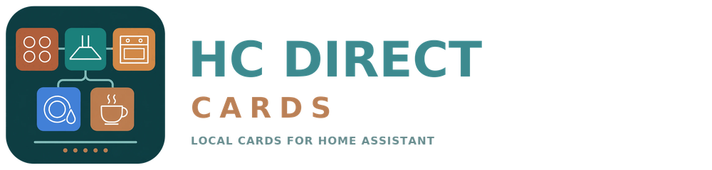

<p align="center">
<picture>
<source media="(prefers-color-scheme: dark)" srcset="https://raw.githubusercontent.com/Asmir1975/hc-direct-cards/main/assets/logo-dark.png">

</picture>
</p>
<p align="center"><strong>Five kitchen appliances. One clear interface.</strong></p>
<p align="center"><a href="README.md">English</a> · <a href="README.de.md">Deutsch</a></p>
<p align="center">
<a href="LICENSE"></a>
<a href="https://github.com/Asmir1975/homeconnect_direct"></a>


</p>

**HC Direct Cards** adds a hob, extractor hood, oven, dishwasher and coffee
machine card to Home Assistant. Made by
[Asmir1975](https://github.com/Asmir1975) for
[Home Connect Direct](https://github.com/Asmir1975/homeconnect_direct).

The cards are an optional companion to the integration: they show what the
integration provides and send its own values, nothing more.

Pick the appliance in the visual editor and the card assigns the matching
entities automatically. The main view shows everyday controls; further values
and settings fold out below.

## The five cards

| Appliance | Card type | What it shows |
|---|---|---|
| Hob | `custom:hc-direct-hob-card` | Four zones, residual heat, timers; reported Join and powerMove state |
| Extractor hood | `custom:hc-direct-hood-card` | Available fan levels, light and dimming, filter values |
| Oven | `custom:hc-direct-oven-card` | Program, target temperature, duration and available extras |
| Dishwasher | `custom:hc-direct-dishwasher-card` | Program, start/cancel, remaining time and messages |
| Coffee machine | `custom:hc-direct-coffee-card` | Beverage, amount, aromaSelect, strength and available extras |

A function is only shown when a matching entity is assigned. The cards do not
add capabilities the integration does not provide.

## Languages

The cards follow the Home Assistant language: **English** and **German**.
Field labels use the entity names of Home Connect Direct 1.13.0 in both
languages, so they match the entity list in Home Assistant. Any other language
falls back to English. Option and state names come from Home Assistant itself.

## Installation

Requires a working **Home Connect Direct 1.13.0** integration with available
appliances. The verified entity contract is `homeconnect_ws`. The official Home
Connect cloud integration has a different entity structure.

### Manual

1. Copy `dist/home-connect-direct-cards.js` to
   `/config/www/hc-direct-cards/home-connect-direct-cards.js`.
2. Under **Settings → Dashboards → Resources** add it as a **JavaScript module**:

   ```text
   /local/hc-direct-cards/home-connect-direct-cards.js?v=1.0.0
   ```

3. Fully reload the browser.
4. Add a card, for example:

   ```yaml
   type: custom:hc-direct-coffee-card
   ```

5. Select the appliance in the visual editor.

Load only one version of this card package at a time. Existing `hc-direct`
card types stay valid. For existing cards, use the recommended size on the
**Layout** tab or choose 12 columns.

### HACS

Add `https://github.com/Asmir1975/hc-direct-cards` under **HACS → ⋮ → Custom
repositories** with type **Dashboard**, then download **HC Direct Cards** and
reload the browser. The repository contains `hacs.json` and the built JavaScript
in `dist`.

### Switching or removing

Change the existing resource entry instead of adding a second one, then reload
completely. To go back, use the previous JavaScript file and its resource URL.
The integration and its configuration are not changed by this package.

## Automatic device detection

The selection stores the device ID. Assignment uses the entity registry, the
integration platform and stable entity keys. Renamed entity IDs are picked up
when the registry is resolved again. Disabled, hidden or missing entities are not
used automatically. Ambiguous matches stay empty. Manual assignments are kept.

An **anchor entity** is the alternative way to identify the device: pick one
entity of the appliance and the card finds the other entities of the same device
through its device assignment.

## Hob

The physical layout is confirmed for the **Siemens EX851LYV5E**:

```text
200    300
100    400
```

Join shows one joint rectangle per side. powerMove shows two vertical lines per
side and reads rear/middle/front from the existing settings. The display follows
the reported Join/mode state, not just the click. Zone values are read-only;
tapping opens the entity details.

Other hob layouts are not verified. The global Join/mode entities do not allow a
proven independent left/right mode display. There is no added zone power control
and no remote-start function for the hob.

## Compatibility and known limits

- Works with Home Connect Direct 1.13.0 (`homeconnect_ws`). Appliances that the
  integration does not expose are not available in the cards.
- The hob layout is confirmed for the Siemens EX851LYV5E only.

## Development

Node.js 24 is required. `npm ci`, `npm test`, `npm run build`; an offline demo runs
with `npm run demo` at `http://localhost:5173/dev/demo/` (add `?lang=en` for the
English texts). It uses saved sample entities and never contacts Home Assistant or
appliances. See [Architecture](docs/ARCHITECTURE.md),
[Contributing](.github/CONTRIBUTING.md) and [Changelog](CHANGELOG.md).

## Credits and license

**Asmir1975** · [MIT license](LICENSE) · [Third-party notices](docs/legal/THIRD_PARTY_NOTICES.md)

Parts of the card code derive from
[Home Connect Card Pack](https://github.com/leMax6608/home-connect-card-pack)
by leMax6608 (MIT). Thank you for the foundation. The original notice is kept in
[docs/legal/HC_CARD_PACK_MIT.txt](docs/legal/HC_CARD_PACK_MIT.txt). Home Connect,
Bosch, Siemens and Home Assistant are trademarks of their respective owners; see
[docs/legal/TRADEMARKS.md](docs/legal/TRADEMARKS.md).
